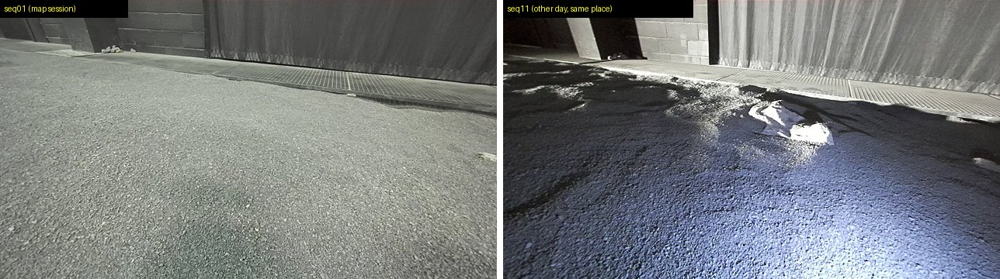
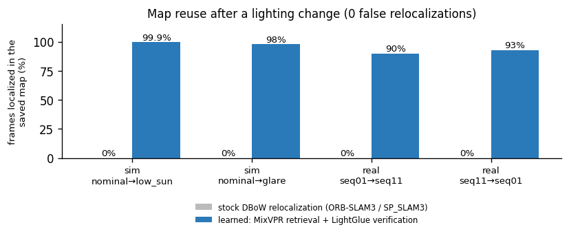
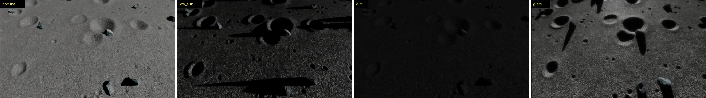
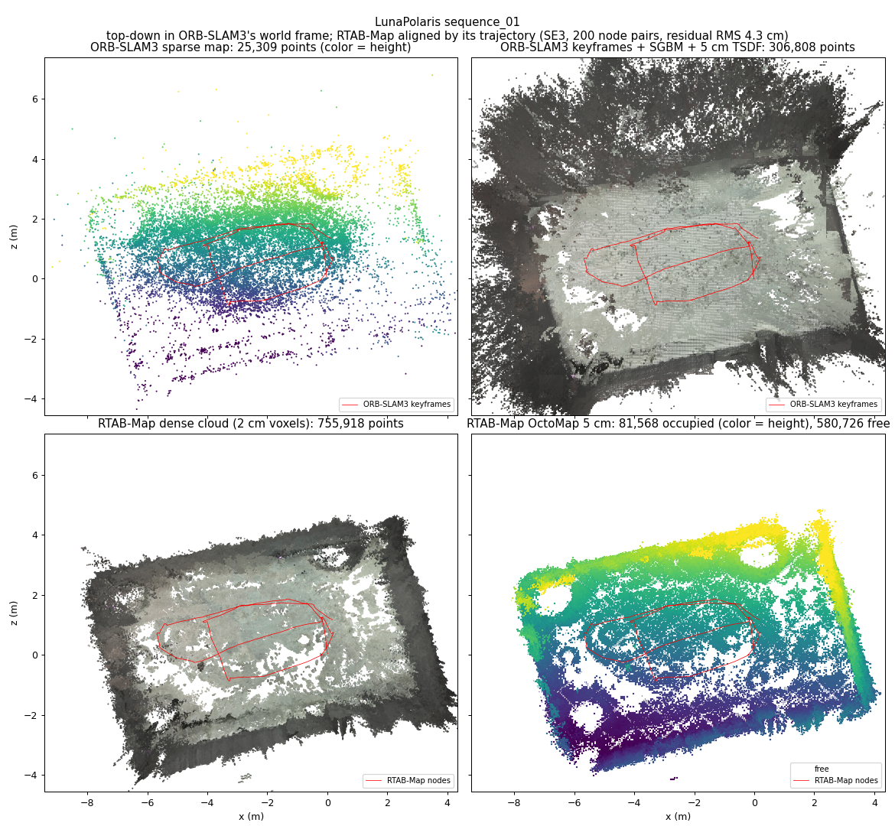

# slam-benching

A benchmark for **reusable SLAM maps on lunar terrain**. The end goal is a drone that maps terrain once,
so a lander or rover can later localize in that map, even when the sun has moved.

The harness runs existing SLAM systems unmodified (or with small recorded patches) in containers,
on real lunar-analogue data and on simulated renders, and scores accuracy, map reuse, map quality and
compute cost the same way for each.


*The same spot in the LunaPolaris dataset on two days. A map built on the left must still work on the right.*

## What we found

1. **Single-session stereo SLAM already works.** ORB-SLAM3 reaches 3–8 cm error on LunaPolaris;
   learned features (SuperPoint/LightGlue) give no clear gain.
2. **Map reuse breaks when the lighting changes.** Same lighting: 92–100 % of frames localize in the
   saved map. Different sun angle or day: **0 %**.
3. **The failure is place recognition**, not matching or pose estimation. Bag-of-words retrieval finds
   the right map image about 3 % of the time across lighting.
4. **Learned retrieval + learned matching fixes most of it.** Adding MixVPR retrieval and
   SuperPoint+LightGlue verification inside SP_SLAM3 brings reuse to 90–99.9 % localized, with no
   false relocalizations:

   
5. **LiDAR alone is not the answer.** Ground-only LiDAR-inertial odometry diverges silently on open
   terrain, so the remaining gap points to camera–LiDAR–IMU fusion with cross-checks.

Details, caveats and open work: **[docs/research_summary.md](docs/research_summary.md)** (start here).

## Data

| Source | What | Used for |
|---|---|---|
| [LunaPolaris](https://zenodo.org/records/15737938) (real) | Rover stereo, IMU, LiDAR and mocap ground truth in the LunaLab (Luxembourg), seq01/02/11 on different days | accuracy, cross-day map reuse, map quality |
| OmniLRS / Isaac Sim (simulated) | Stereo renders with exact ground truth: LunaLab digital twin, procedural Lunaryard, real-DEM LargeScale | controlled lighting, aerial surveys |
| TUM-VI room1 | standard VIO benchmark | installation check |


*The same simulated aerial view (Lunaryard, 5 m altitude) under the four lighting conditions.*


*Maps of LunaPolaris seq01: ORB-SLAM3 sparse and dense (top), RTAB-Map dense cloud and OctoMap (bottom).*

## Estimators

| System | Sensors | Notes |
|---|---|---|
| ORB-SLAM3 | mono, stereo (+IMU) | CPU baseline, map save/load |
| SP_SLAM3 | stereo | ORB-SLAM3 with SuperPoint/LightGlue; our patches add learned relocalization (GPU) |
| RTAB-Map | stereo | dense maps, map reuse |
| FAST-LIO2 | LiDAR + IMU | voxel map export |
| LAC SLAM (Stanford) | stereo | SuperPoint/LightGlue VO + GTSAM (GPU) |

## Quick start (PACE ICE)

```bash
python3 -m venv ~/scratch/slam-bench-work/venv && source ~/scratch/slam-bench-work/venv/bin/activate
pip install -e '.[test]' && pytest -q                    # no data needed

# build an estimator image once (see docs/usage.md), then run one experiment:
sbatch -p ice-cpu --constraint=gold6226 -c 8 --mem=32G -t 03:00:00 scripts/slurm_slambench.sbatch \
       run configs/lunapolaris/lunapolaris_seq01_orbslam3_stereo.yaml
# -> ~/scratch/slam-bench-work/runs/<experiment>/<run id>/ (summary.csv, eval/metrics.json, plots)
```

Every experiment is one YAML in [`configs/`](configs/README.md). Raw data, prepared inputs, containers
and run outputs live outside the repo (`~/scratch/slam-bench-work`).

## Documentation

| Doc | Contents |
|---|---|
| [research_summary](docs/research_summary.md) | **Start here.** Question, claims with evidence, open work |
| [usage](docs/usage.md) | Repository layout, setup, container builds, running, replay viewer, map reuse, config and output reference |
| [AGENTS.md](AGENTS.md) | PACE cluster notes: GPUs, storage, quotas |
| [evaluation](docs/evaluation.md) | Association, frames, alignment, ATE/RPE, coverage, timing |
| [adapter_interface](docs/adapter_interface.md) | How to add a dataset or estimator |
| [datasets/lunapolaris](docs/datasets/lunapolaris.md), [datasets/omnilrs](docs/datasets/omnilrs.md) | Topics, calibration, frames; sim render pipeline |
| [results/](docs/results/) | One page per study: [map_reuse](docs/results/map_reuse.md), [place_recognition](docs/results/place_recognition.md), [lac_lunapolaris](docs/results/lac_lunapolaris.md), [lunaryard_aerial_lighting](docs/results/lunaryard_aerial_lighting.md), [largescale_trial](docs/results/largescale_trial.md), … |
| [research/](docs/research/) | [Ground-only LiDAR](docs/research/lidar_ground_only.md), [lens flare](docs/research/lens_flare_restoration.md) |

README figures are regenerated with `scripts/make_readme_figures.py`.

## Licences
LunaPolaris: CC BY 4.0, © 2025 University of Luxembourg — Database by Dave van der Meer,
SnT – SpaceR. ORB-SLAM3: GPLv3 (built inside the container, not redistributed here). RTAB-Map: BSD-3-Clause
(built inside the container). FAST-LIO: GPLv2 (built inside the container; only a patch is kept here).
LAC (Stanford NAV Lab): MIT; LightGlue: Apache-2.0; SuperPoint weights: Magic Leap non-commercial
licence (all fetched inside the container, not redistributed here). SP_SLAM3: GPLv3 (ORB-SLAM3
derivative; built inside the container, only patches are kept here; its SuperPoint and LightGlue
weights are under the licences above).
TUM-VI: CC BY 4.0. OmniLRS: BSD-3-Clause; Isaac Sim: NVIDIA licence
(container pulled from NGC, not redistributed here).
