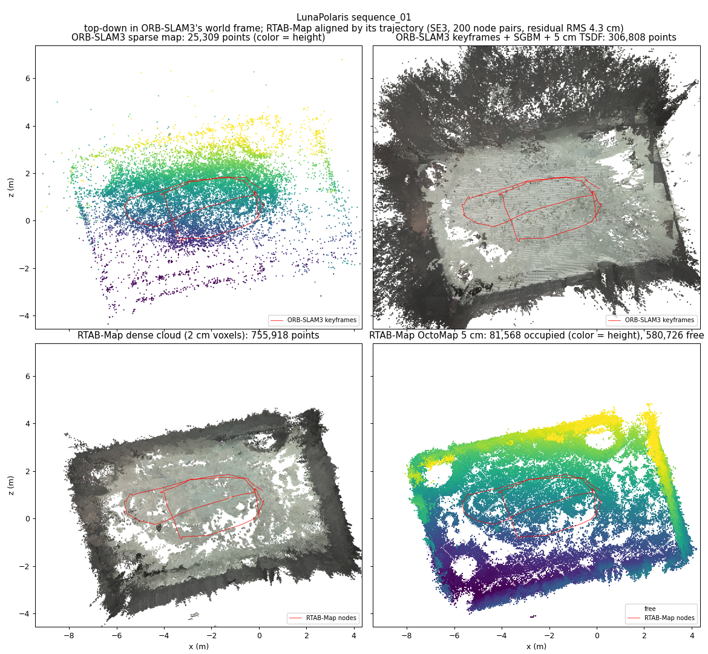

# Compute cost: ORB-SLAM3 vs RTAB-Map stereo (LunaPolaris)

Configs: `configs/lunapolaris_seq{01,02,11}_{orbslam3,rtabmap}_stereo_lean.yaml`, 3 repeats each,
Slurm `--constraint=gold6226` (Xeon Gold 6226, 8 cores per job), `playback_rate: 1.0`.

## What was made comparable
The first comparison (default configs) was not like-for-like:
* RTAB-Map's per-frame time included its 1 Hz map update, because our driver ran odometry and map
  update one after the other; ORB-SLAM3 reports only its tracking thread (local mapping and loop
  closing run on their own threads). The lean RTAB-Map configs use `threaded_map_update: true`
  (map updates on a worker thread, as rtabmap_ros' separate nodes do), so both report the
  per-frame front end only.
* RTAB-Map built per-node 3D occupancy grids during the run and exported a dense cloud and OctoMap
  after it, inside the measured process tree. Lean configs: `occupancy_grid: false`, no export.
* Both logged per-frame keypoints (`features.bin`); lean configs: `log_features: false`.

Both use binary descriptors (ORB-SLAM3: ORB; RTAB-Map default: GFTT corners + BRIEF), so the
difference is not the descriptor type.

## Results (mean over 3 repeats; [min, max])

| Seq | Estimator | ATE RMSE (m) | Per-frame time mean / p95 (ms) | Frames over 68 ms | CPU per frame (ms) | Peak RSS (MB) |
|---|---|---|---|---|---|---|
| 01 | ORB-SLAM3 | 0.032 | 25 / 33 | 0% | 78 [74, 84] | 1136 |
| 01 | RTAB-Map | 0.067 | 59 / 68 | 6% | 81 [81, 82] | 514 |
| 02 | ORB-SLAM3 | 0.059 | 25 / 32 | 0% | 71 [67, 75] | 974 |
| 02 | RTAB-Map | 0.056 | 62 / 75 | 20% [9, 36] | 85 [81, 90] | 521 |
| 11 | ORB-SLAM3 | 0.081 | 25 / 31 | 0% | 67 [66, 67] | 679 |
| 11 | RTAB-Map | 0.084 | 64 / 74 | 30% [27, 32] | 88 [87, 89] | 495 |

* Per-frame time: ORB-SLAM3 tracking thread; RTAB-Map odometry (map updates on their own thread).
* CPU per frame: user + system CPU of the whole process tree (all threads, incl. mapping / loop
  closing / map updates and image decoding) divided by the number of frames, excluding the first
  25 s (vocabulary / parameter loading). Every RTAB-Map map update was processed (none dropped).
* RTAB-Map's CPU split (`driver_timing.json`): odometry ~58 ms per frame, map updates (graph,
  loop closure) only ~5% of its CPU.

## Conclusions
* ORB-SLAM3's front end is ~2.5x faster per frame (25 vs 59–64 ms) and its p95 is ~55% lower;
  it never exceeded the 15 Hz frame period, RTAB-Map's odometry did on 6–30% of frames.
* Total CPU per frame is close: ORB-SLAM3 used 4–24% less (seq01 / seq02 / seq11: 4% / 16% / 24%).
  ORB-SLAM3 spreads its work over tracking + mapping threads; RTAB-Map's is mostly one
  single-threaded odometry.
* RTAB-Map used about half the memory (~510 vs 680–1140 MB; ORB-SLAM3 holds its vocabulary).
* Accuracy is comparable on seq02 / seq11; ORB-SLAM3 is twice as accurate on seq01.
* Compared with the default configs, threading the map update cut RTAB-Map's p95 from ~150 ms
  to 68–75 ms; dropping grids/export cut its total CPU by ~5–10%.

## Cost of RTAB-Map's dense map
`configs/lunapolaris_seq{01,02,11}_rtabmap_stereo_dense.yaml` are the lean RTAB-Map configs with
per-node 3D occupancy grids (0.05 m cells, 5 m range, from stereo depth) and the post-run dense cloud
+ OctoMap export switched back on. 3 repeats each; means over all 9 runs per variant:

| | Lean (no dense map) | Dense | Change |
|---|---|---|---|
| ATE RMSE (m), seq01 / 02 / 11 | 0.067 / 0.056 / 0.084 | 0.058 / 0.056 / 0.089 | within repeat noise |
| Odometry per frame, mean / p95 (ms) | 61 / 72 | 60 / 70 | none (grids are not on the front end) |
| Map update CPU (ms per 1 Hz update) | 51 | 94 | +85% |
| CPU per frame, whole driver (ms) | 85.5 | 90.0 | +5% |
| Post-run export (cloud + OctoMap) | — | 25 s CPU, 15 s wall | one-off |
| Total CPU incl. export (s) | 1139 | 1223 | +7% |
| Peak RSS (MB) | 510 | 685 | +34% |
| Map database (MB) | 282 | 510–675 | ~2.1x |

* In threaded mode the grids only load the map-update thread (~10% of one core at 1 Hz), so per-frame
  latency is unchanged; no update was dropped. Odometry dominates either way.
* The grids are per-node local maps; the global OctoMap is only assembled by the post-run export.
  A live global map (as rtabmap_ros' map assembler publishes) would add work not measured here.
* Against ORB-SLAM3 (no dense map): RTAB-Map with the dense map uses ~26% more CPU per frame
  (90 vs 72 ms) and ~25% less memory (685 vs 930 MB), at 2.5x the per-frame front-end latency.

## Prototype: dense map on top of ORB-SLAM3
`scripts/dense_from_keyframes.py <orbslam3 run>` (`pip install -e .[dense]`) post-processes a run:
SGBM stereo depth for each keyframe of the final map, fused into a 5 cm TSDF at the keyframe's final
(loop-closed) pose, then marching cubes. Lean ORB-SLAM3 runs, one per sequence, 8-core ice-cpu node:

| Seq | Keyframes | Per keyframe: SGBM / TSDF fusion (ms) | Total CPU | Mesh | Sparse points within 5 cm of mesh (median dist) |
|---|---|---|---|---|---|
| 01 | 819 | 56 / 19 | 108 s | 452k triangles, 21 MB | 86% (2.2 cm) |
| 02 | 544 | 56 / 16 | 67 s | 335k triangles, 15 MB | 89% (1.4 cm) |
| 11 | 174 | 56 / 19 | 23 s | 380k triangles, 18 MB | 85% (1.4 cm) |

Top-down maps of seq01: ORB-SLAM3 sparse points, the keyframe TSDF, RTAB-Map's dense cloud and its
OctoMap (occupied cells by height over free cells), with RTAB-Map aligned to ORB-SLAM3's frame by its
trajectory (`scripts/plot_dense_maps.py`). Same for [seq02](figures/seq02_dense_maps.png) and
[seq11](figures/seq11_dense_maps.png). The height gradient across the floor is the tilt of ORB-SLAM3's
world frame (its first camera pose), not terrain.

* Depth is computed only per keyframe (0.2–0.9 per second here, vs RTAB-Map's 1 Hz grids), so done
  online on a background thread this would cost ~75 ms per keyframe, 1.5–7% of one core on average.
  The image load time (~90 ms per pair from scratch) is excluded; a live system already has the images.
* The sparse map points (triangulated and bundle-adjusted independently of SGBM) agree with the fused
  surface to ~1.5–2 cm, so the keyframe poses and stereo depth are consistent.
* The TSDF surface covers more 10 cm cells than RTAB-Map's exported cloud (48–68k vs 28–39k; ORB
  sparse map: 3–6k), partly because a TSDF surface is a few voxels thick and noisy depth at range
  (e.g. the dark backdrop) adds fringe. Accuracy against ground-truth geometry is measured below.
* Limits: offline (after the run), no online map updates on loop closure, SGBM single-threaded, no
  free-space / occupancy output (the TSDF has it implicitly; an OctoMap export would be next).

## Caveat: input reading did not keep up with real time
Wall time per frame was ~96 ms (ORB-SLAM3) and ~133 ms (RTAB-Map) against the 68 ms frame period:
reading a stereo PNG pair from the shared scratch filesystem takes ~90 ms, so playback ran ~1.4x /
~1.9x slower than real time (repeats started together ran in lockstep). Per-frame compute time and
CPU per frame are unaffected, but each estimator's background work (ORB-SLAM3 local mapping,
RTAB-Map map updates) had more wall time per frame than on a live robot. A true real-time test needs
the input staged on node-local disk or in memory.
